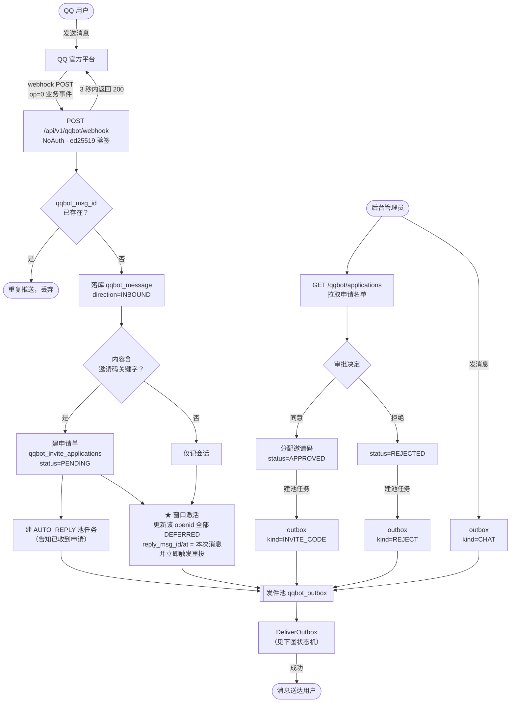
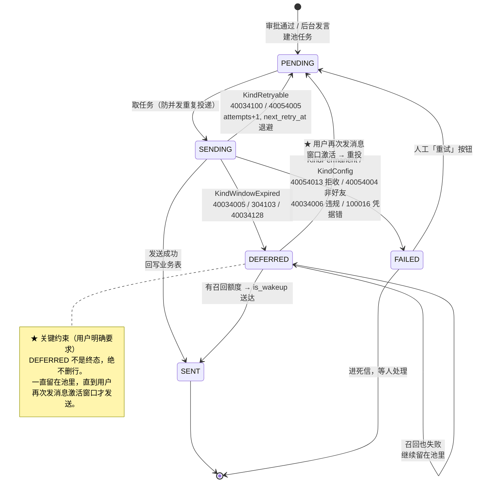
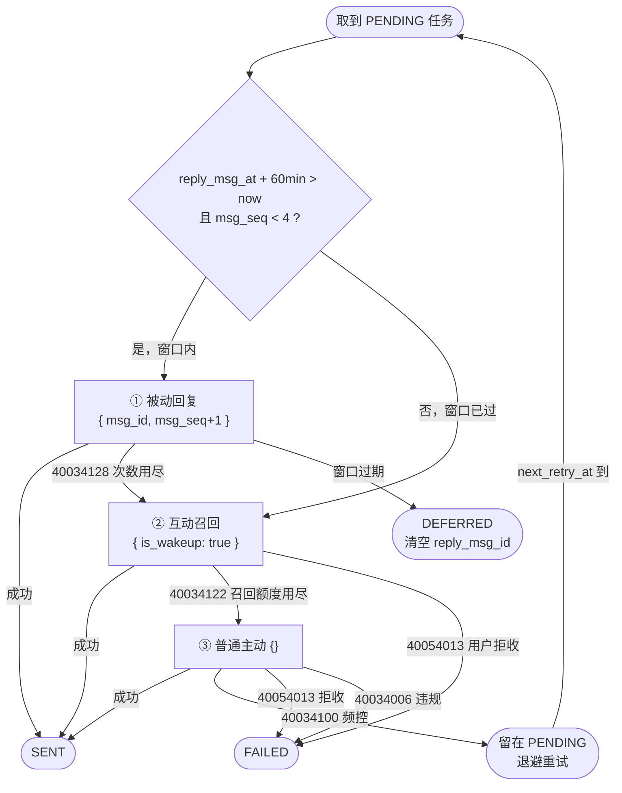
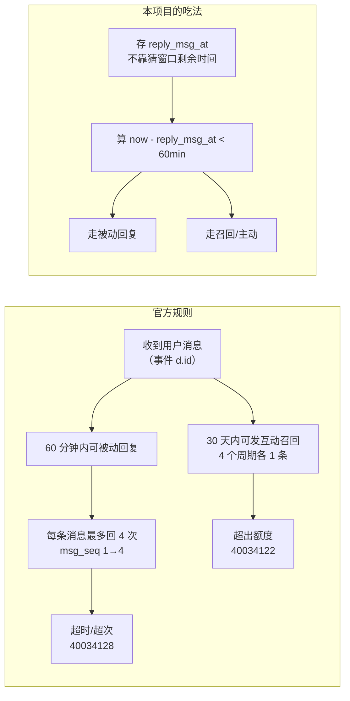
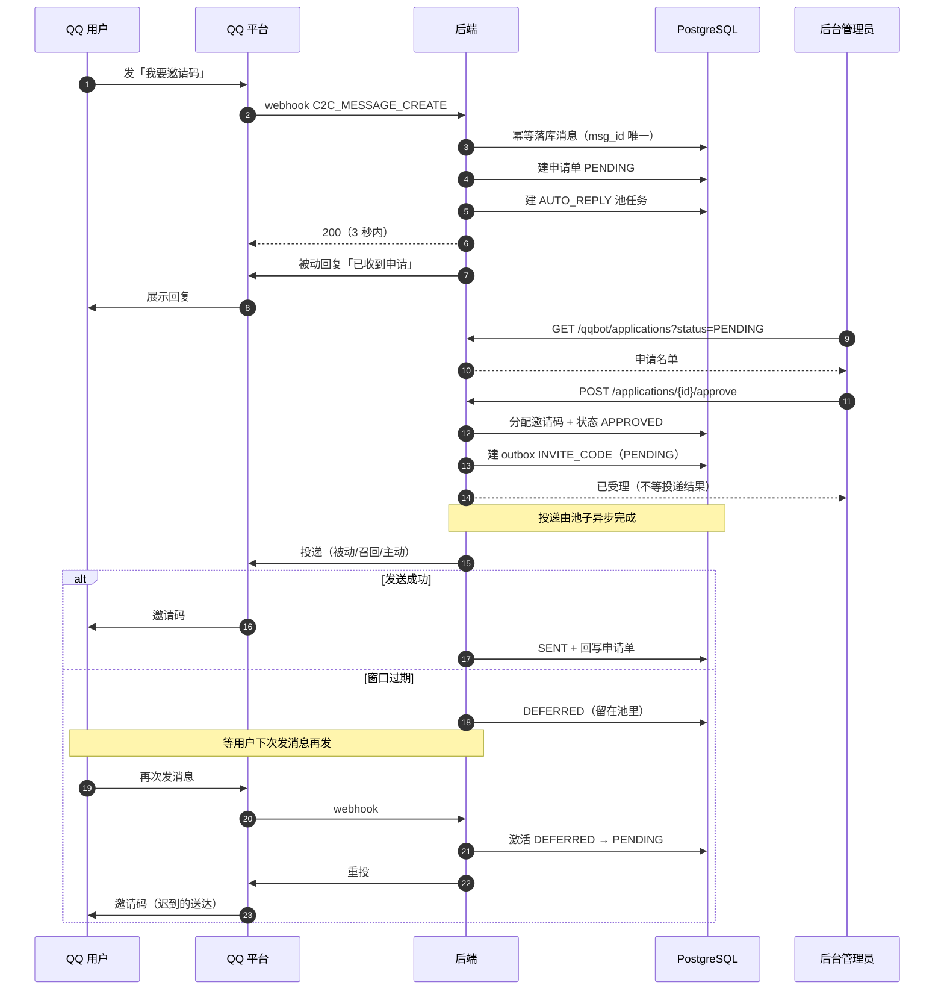
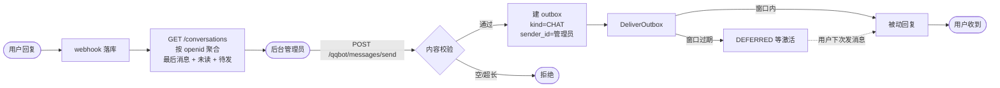
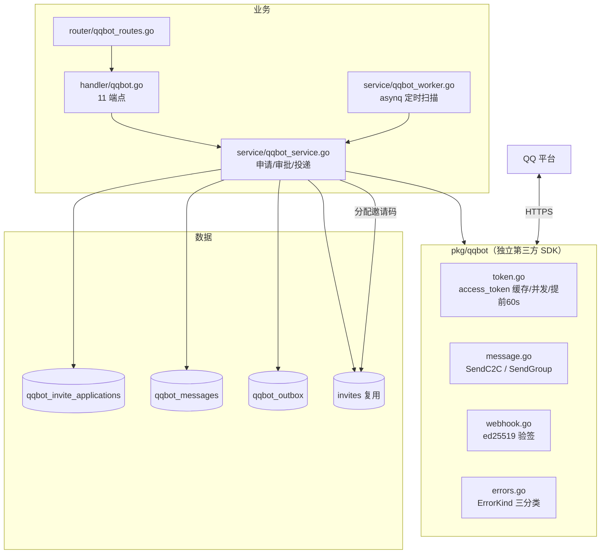

# 30 — QQ 机器人功能流程图

> 配套说明见 `docs/29-QQ机器人接入调研.md`（官方事实）与 `internal/model/qqbot.go`（表结构）。
> 图用 Mermaid 编写，GitLab / GitHub / VS Code / Typora 均可直接渲染。

---

## 一、整体功能流程（主链路）

**要点**：审批**不直接发消息**，一律「建池任务 → 由池子投递」。
这样窗口过期、用户拒收、频控所有异常路径都由池子统一兜住，审批逻辑保持纯净。

---

## 二、发件池状态机（本项目核心）

**三分类的唯一判据**是 `qqbot.ErrorKind`（`pkg/qqbot/errors.go` 的 `KindOf`）——
调用方不认识任何官方错误码，SDK 已经把 40+ 个码归成三类。

---

## 三、单次投递的尝试顺序（DeliverOutbox 内部）

**为什么是这个顺序**：被动回复送达率最高（用户刚说过话，必然能收到）；
召回次之（30 天窗口，不消耗主动消息配额）；普通主动最后（受用户开关限制，最容易失败）。

---

## 四、时效窗口判定（最容易做错的地方）

| 数据 | 存在哪 | 作用 |
|---|---|---|
| `reply_msg_id` | `qqbot_outbox` | 被动回复要带的 `msg_id` |
| `reply_msg_at` | `qqbot_outbox` | **判断 60 分钟窗口是否还有效** |
| `msg_seq` | `qqbot_outbox` | 已用到第几次，上限 4 |

---

## 五、审批时序（后台视角）

---

## 六、后台与用户对话

**后台发言同样走池子** —— 不是直接调 SDK。理由：管理员点「发送」时用户窗口
大概率已过期，直发会失败且管理员看不到原因；走池子则要么送达要么进 `DEFERRED`
等激活，状态在 `GET /qqbot/outbox` 里可查、可人工重试。

---

## 七、组件与依赖关系

**SDK 不依赖本项目任何内部包**（只有标准库），可被任意 Go 项目直接引用；
业务侧通过 `qqbot.Client` 接口调用，不直接碰 HTTP。
